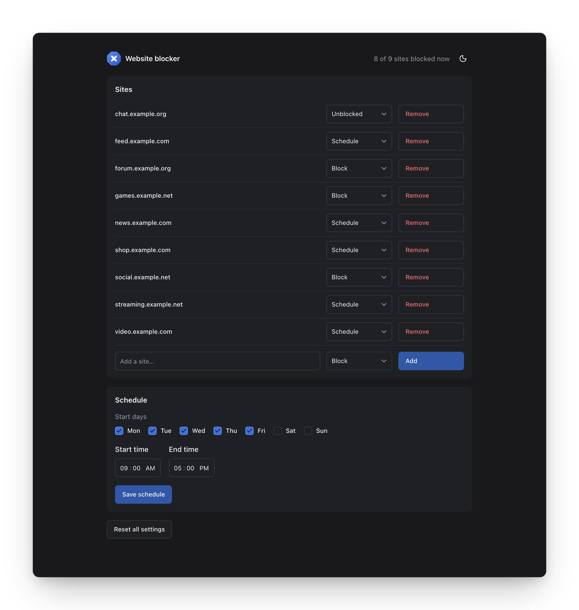

# chrome-website-blocker

Chrome extension to block websites in a list on a schedule so you can stayed focused and get shit done.

Apparently all extensions that offer this functionality require you share
ridiculous amount of data or are just overly complicated.

This extension simple, OSS, no data collected

**Personal project**: This is completely vibe coded for my own personal use. I won't be accepting feature requests or PRs. You're welcome to fork it and make it your own.

